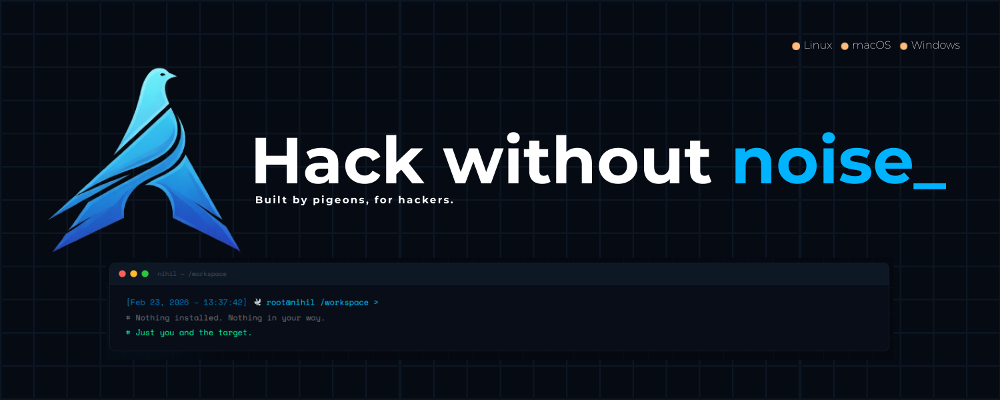

Nihil is a minimal offensive environment for security experts, hackers, and students. It provides ready-to-use Docker images and a CLI to spin up a lab without dealing with base distributions or manual installs. It is transparent, modular, and built for real work.

Want to know more? Go to the [project website](https://thenullpigeons.org).

## Getting started

Install Nihil from the [getting started guide](https://thenullpigeons.org/docs/installation/linux).

The project documentation for images, CLI, and usage is available on the [documentation site](https://thenullpigeons.org/docs).

## Third-party licensing

The Nihil wrapper includes certain code from Exegol released under GPLv3 before 5 June 2025, as well as other third-party source code. See the [Exegol license](https://github.com/ThePorgs/Exegol/blob/master/LICENSE.md) for details.
